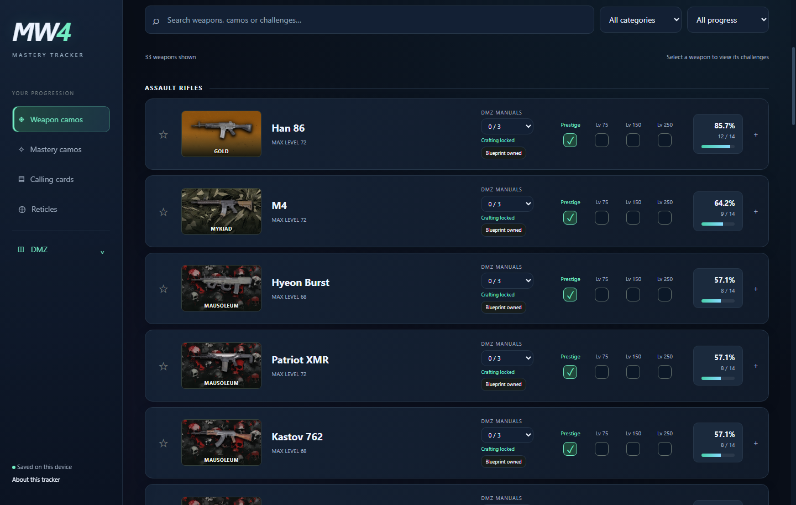
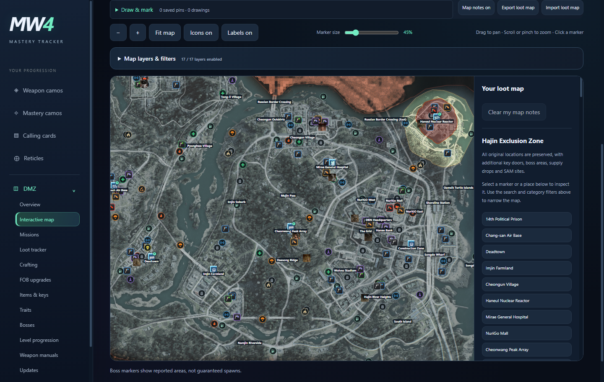
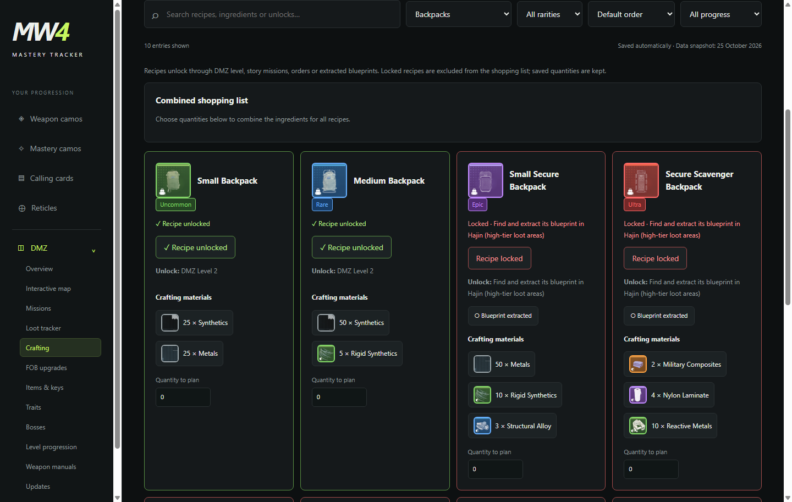
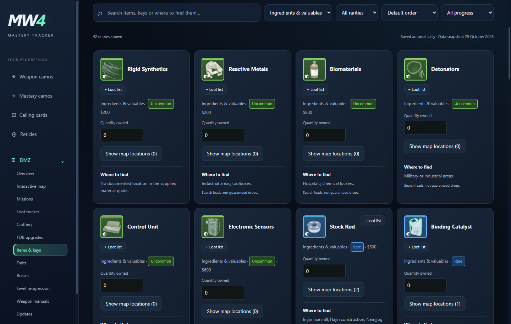
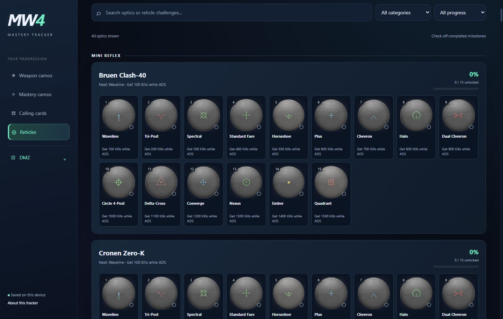

<div align="center">

# MW4 Mastery Tracker

### Every weapon. Every camo. Your next objective.

Track the grind, plan your crafts, and build your next DMZ loot route—all in one offline Windows app.

[](https://github.com/thenotsoquietninja44-collab/mw4-mastery-tracker/releases/latest)


**[Download for Windows](https://github.com/thenotsoquietninja44-collab/mw4-mastery-tracker/releases/latest) · [See it in action](#screenshots) · [Back up your progress](#backups)**

No account required. Your progress stays on your PC.

</div>

---

## Make every run count

- **See the grind at a glance.** Each weapon sits over its highest completed camo, with completion percentages and prestige milestones beside it.
- **Keep camo progress connected.** Completing a later camo automatically ticks its prerequisites. Multiplayer and DMZ challenge routes share the same completion. The main total counts only weapon camos. Account-wide mastery camos and War Spoils have separate counts in the Mastery camos tab. The main total counts only weapon camos. Account-wide mastery camos and War Spoils have separate counts in the Mastery camos tab.
- **Find your sight picture.** Track 520 reticles across 40 optics with images, named unlocks, ADS kill challenges, and automatic prerequisite completion.
- **Track War Spoils separately.** Open Mastery camos for a dedicated 33-weapon section, its own completion count, and linked weapon-manual controls.
- **Plan your next craft.** Check recipe unlocks, required materials, and a combined shopping list. Track weapon manuals, extracted blueprints, and FOB upgrades.
- **Know what you have—and what you need.** Track item and key quantities, filter by rarity, and look up available material locations and key instructions.
- **Build a loot map with your squad.** Explore Hajin with searchable layer filters, loot and boss presets, ingredient search areas, and personal marker color filters. Draw routes and place colored pins or item markers. Export your map notes and merge maps shared by friends.
- **Keep your progress protected.** Automatic backups run before in-app updates install. Restore a saved backup directly from the Help menu.

## Get started

1. Open the **[latest release](https://github.com/thenotsoquietninja44-collab/mw4-mastery-tracker/releases/latest)** and download the `MW4-Mastery-Tracker-Setup-…exe` installer.
2. Run the installer and open **MW4 Mastery Tracker**.
3. Start with a blank tracker and mark the progress you've already earned. Changes save automatically.

**Requires:** Windows 10 or 11, 64-bit. The installer includes the app's images and map, so tracking works offline. An internet connection lets the app check for updates.

The installer is unsigned, so Windows may show an unrecognized publisher warning.

## Screenshots

Click any screenshot to open it at full size. These previews show example saved progress.

| Weapon camos & prestige | Interactive Hajin map |
| --- | --- |
| [](screenshot-weapons.png) | [](screenshot-map.png) |
| **Crafting & recipe unlocks** | **Items, keys & inventory** |
| [](screenshot-crafting.png) | [](screenshot-items.png) |

### Reticle tracker

[](screenshot-reticles.png)

## Your next deployment

### Pick a weapon. See what's next.

Open **Weapon camos** to see each gun's earned camo backdrop, completion percentage, extracted manuals, and prestige milestones. Open a gun to view its challenges. The backdrop follows the furthest completed weapon camo and updates when you change your progress.

### Turn your stash into a plan.

Use **DMZ → Items & keys** to track quantities and check available location information. **Crafting** brings recipes, unlock requirements, and materials together. Click a material to open its inventory entry, or hover over it for a location hint.

### Share the route. Keep your own progress.

Open **DMZ → Interactive map → Draw & mark** to add pins, item icons, notes, and drawn routes.

- **Map layers & filters** offers quick presets, individual icon layers, ingredient toggles, and custom marker colors. Ingredient search areas appear by default; shared locations are grouped into one clickable pin.
- **Export loot map** creates a file you can share with your squad.
- **Import loot map** merges markers and drawings while skipping duplicates.
- **Show map locations** on an inventory item shows matching saved pins, built-in key locations, and mapped search areas from the material guide. The count shows which kinds of locations are available. Search-area pins are broad leads, not exact or guaranteed loot spawns. Markers also link back to the item.

Map-sharing files contain map notes only. Your inventory and progression stay separate. Full progress backups include your map notes too.

## Backups

Your progress saves automatically on this PC. For a separate copy, use:

| Action | Where to find it |
| --- | --- |
| Save a dated backup on this PC | **Help → Create progress backup** |
| Restore an automatic or exported backup | **Help → Restore from backup** |
| Browse your saved backups | **Help → Open backups folder** |
| Save a portable copy for another PC | **Export progress**, at the top of the app |
| Load a portable copy | **Import progress**, at the top of the app |

Before an in-app update installs, the app saves and verifies a dated backup. If it can't create that backup, installation pauses. A snapshot is also saved when an update finishes downloading.

Restoring through **Help → Restore from backup** first saves your current progress, then loads the selected backup. Automatic backups remain on your PC across updates and are not automatically deleted. Keep an exported copy somewhere separate if you want protection against losing the PC or its drive.

## Updates

The app checks GitHub Releases at startup. Available updates download in the background and ask before restarting to install.

To check manually, use **Help → Check for updates**. You can keep using the tracker offline when a check isn't available.

## Good to know

- This is a manual companion tracker. It doesn't read your game account or sync progress from the game.
- Saves are local to this PC. Use a progress backup to transfer them to another device.
- Location hints are search leads, not guaranteed loot drops. Boss markers show reported areas, not guaranteed spawns.

---

<details>
<summary><strong>For developers: build and release</strong></summary>

### Build from source

Install Node.js 24 LTS. From the repository folder, run:

```powershell
Expand-Archive -LiteralPath app-source.zip -DestinationPath . -Force
npm ci
node scripts/unpack-ui.cjs
Expand-Archive -LiteralPath .build/ui.zip -DestinationPath . -Force
Expand-Archive -LiteralPath ui-update.zip -DestinationPath . -Force
npm test
npm run build:win
```

The installer, `latest.yml` update manifest, and blockmap are written to `release/`.

Desktop code, tests, and build scripts are stored in `app-source.zip`. The multipart `ui-assets` archive contains the base UI and local artwork; its SHA-256 is verified before extraction. Apply `ui-update.zip` afterward for the current UI changes. The extracted UI source is under `ui/`.

### Publish a release

Update the version in `package.json` and `package-lock.json`. Refresh `app-source.zip` when desktop code, scripts, or tests change, and `ui-update.zip` when UI files change. Commit the updated files, then tag the commit `vX.Y.Z` and push the tag.

GitHub Actions builds the Windows installer and publishes its `.exe`, `.blockmap`, and `latest.yml` together. Installed apps use that release feed for updates.

Keep `appId`, `productName`, the persistent tracker partition, and the `app://tracker` origin stable so future versions continue loading existing saves.

</details>
